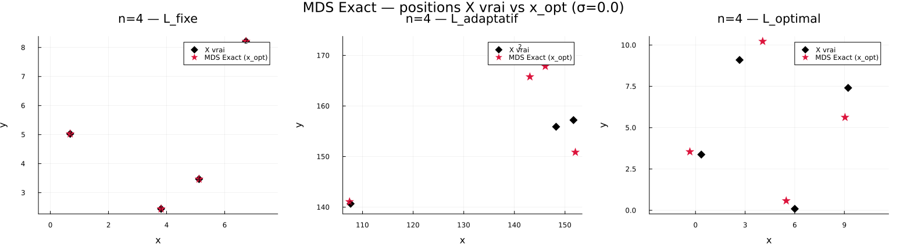
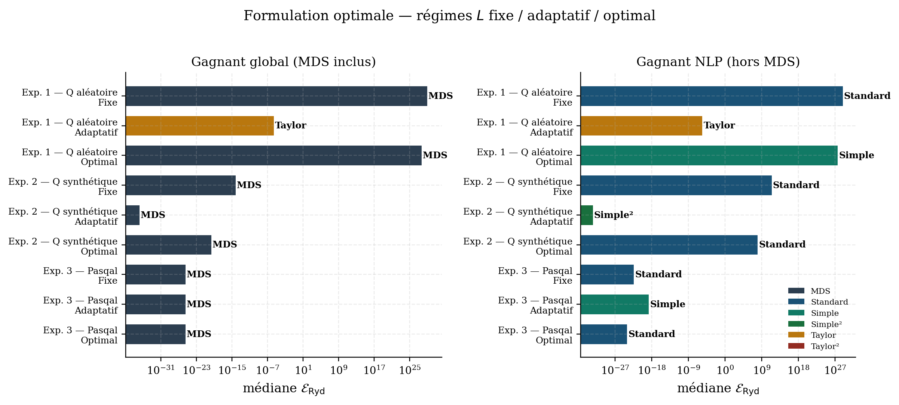
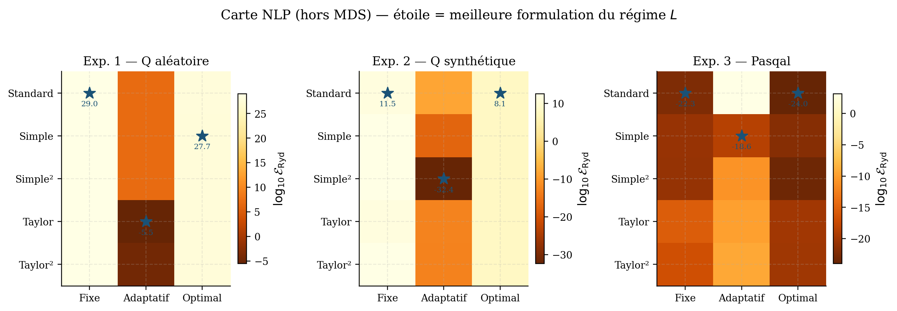
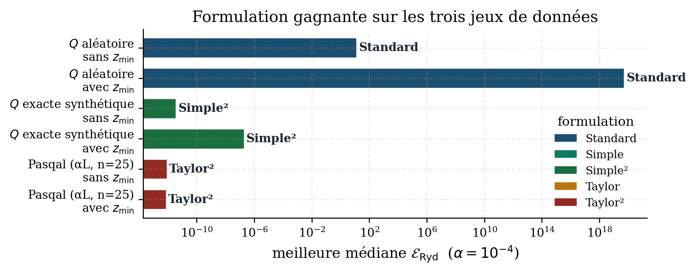
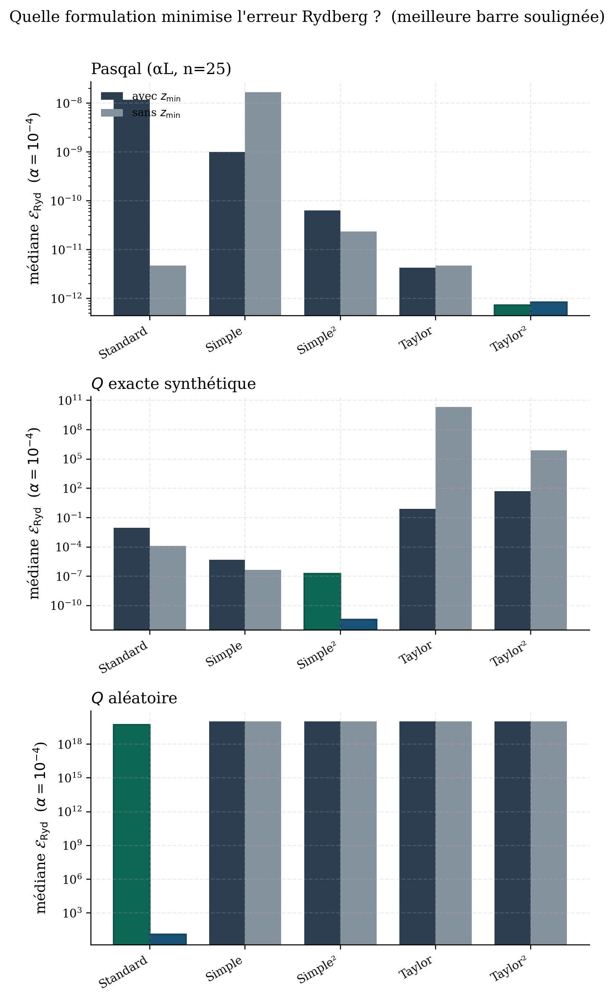
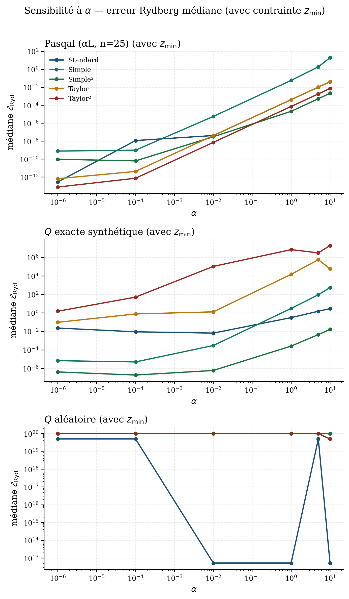

# The reconstruction of Rydberg atoms

Recover the planar positions of neutral Rydberg atoms from a van der Waals interaction matrix, and measure which mathematical formulation actually reconstructs the geometry.

Given couplings $Q_{ij}$, the physical law is

$$
Q_{ij} = \frac{C_6}{\Vert x_i - x_j\Vert ^6}.
$$

The observable is $Q$. The unknown is the point cloud $x_i \in \mathbb{R}^2$. The map is strongly nonlinear, ill-conditioned on weak pairs, and blind to translation, rotation, and reflection: only distances are identifiable. This repository is the Julia study of that inverse problem, written during the 2026 internship at the Laboratoire de Mathématiques d'Avignon (LMA) and the Laboratoire Informatique d'Avignon (LIA).

**Paper.** [Reconstruction de positions d'atomes de Rydberg](benchmark/article/article.pdf) — source in [`benchmark/article/article.tex`](benchmark/article/article.tex). The article states the model, derives the six formulations, and reports four numerical campaigns.

**Résumé.** On reconstruit les positions planes d'atomes de Rydberg à partir de $Q_{ij} = C_6 / r_{ij}^6$. Cinq programmes non linéaires (Standard, Simple, Simple², Taylor, Taylor²) et un MDS spectral exact sont comparés sur trois familles de matrices (aléatoire, synthétique exacte, graphes Pasqal) et sur le choix de l'échelle $L$ de la boîte. Sur données exactement euclidiennes, le MDS domine en précision et en temps. Quand $L$ est une variable pénalisée par $\alpha L$, Simple² reconstruit le mieux les géométries exactes, Taylor² les graphes Pasqal creux, et Standard les matrices aléatoires.

---

## What a successful reconstruction looks like

On exact synthetic data with no noise ($\sigma = 0$), classical multidimensional scaling recovers the reference atoms when the box scale $L$ is fixed. Black diamonds are the true positions. Red stars are the MDS estimate. The two clouds coincide up to the rigid motion that $Q$ cannot see.



The same figure also shows why the box scale is part of the problem. With an adaptive $L$, the atoms are still matched as a shape, but they sit in a much larger window. A tiny Rydberg residual is not, by itself, proof that the geometry was recovered.

---

## The inverse problem

For $C_6 > 0$ (the code uses $C_6 = 1$) the ideal distance implied by a positive coupling is

$$
d_{ij} = \Bigl(\frac{C_6}{Q_{ij}}\Bigr)^{1/6}.
$$

The strongest pair fixes a minimum-distance scale

$$
z_{\min}^{\mathrm{opt}} = \Bigl(\frac{C_6}{Q_{\max}}\Bigr)^{1/6}.
$$

Every solver is judged by the same physical residual, independent of the objective it optimized:

$$
\mathcal{E}_{\mathrm{Ryd}}(x, Q)
= \sum_{i \lt  j}
\Bigl(
  \frac{C_6}{\Vert x_i - x_j\Vert ^6} - Q_{ij}
\Bigr)^2.
$$

When a reference cloud $x^{\mathrm{ref}}$ exists, a second number is required: the root-mean-square error on pairwise distances. A configuration can drive $\mathcal{E}_{\mathrm{Ryd}}$ to numerical zero by stretching the atoms apart (every $1/r^6$ term vanishes) and still be geometrically wrong. A small solver objective is also not a small $\mathcal{E}_{\mathrm{Ryd}}$. That split is the main practical lesson of the Taylor formulations.

A relative distance error propagates as $\delta Q / Q \approx -6\,\delta d / d$. Weak couplings, the small entries of $Q$, therefore carry large uncertainty on the corresponding distances. The problem is non-convex, so the nonlinear programs are started from several initial points.

---

## Six ways to reconstruct the atoms

Five nonlinear programs are solved with Ipopt through JuMP. The sixth method is an exact algebraic embedding.

| Formulation | What is minimized | Role |
|---|---|---|
| **Standard** | $\sum (C_6 / z_{ij}^3 - Q_{ij})^2$, with $z_{ij} = \Vert x_i-x_j\Vert ^2$ | Exact Rydberg residual. $z^3 = r^6$. |
| **Simple** | $\sum (r_{ij} - d_{ij})^2$ | Match the ideal distances. |
| **Simple²** | $\sum (r_{ij}^2 - d_{ij}^2)^2$ | Same match, in squared distances. |
| **Taylor** | $\sum (36 / d_{ij}^{14})\,(r_{ij} - d_{ij})^2$ | Local quadratic model of Standard. |
| **Taylor²** | $\sum (36 / d_{ij}^{14})\,(r_{ij}^2 - d_{ij}^2)^2$ | Squared-distance version of that model. |
| **MDS exact** | Euclidean embedding of $D_{ij}^2 = C_6^{1/3} Q_{ij}^{-1/3}$ | Classical scaling. One eigendecomposition, $\mathcal{O}(n^3)$. |

With $C_6 = 1$, the Taylor weight is $36 / d^{14} = 36\, Q^{7/3}$. Strong pairs receive enormous weights and the nonlinear program becomes badly conditioned. Weak pairs receive almost zero weight, so those distances may wander — or collapse — while the Taylor objective stays small and $\mathcal{E}_{\mathrm{Ryd}}$ explodes. The diagnostic script is `benchmark/test_real/diag_taylor_collapse.jl`.

MDS uses the Young–Householder identity. For a centered cloud, the Gram matrix is $B = -\tfrac12 H D^2 H$ with $H = I - \tfrac1n \mathbf{1}\mathbf{1}^\top$. The point coordinates are recovered from the positive eigenspace of $B$. On a matrix that really comes from a planar point cloud, this is the right answer, and it is fast.

The nonlinear programs remain the right tool when $Q$ is noisy, sparse, or boxed by extra constraints that break the pure distance-geometry hypothesis.

---

## How the box scale $L$ enters

Atoms are sought inside a square $[0, L]^2$, sometimes with the separation constraint $\Vert x_i - x_j\Vert  \ge z_{\min}^{\mathrm{opt}}$.

Three fixed strategies are compared in the first campaigns:

- **Fixed** — $L$ is prescribed (the reference campaign uses $L = 10$).
- **Adaptive** — $L$ grows with the number of atoms ($L = 2\sqrt{n}$ in the early benchmark; a wide box $L = 100\sqrt{n}$ is the stress test).
- **Optimal** — $L$ is set from the strongest coupling, $L = (C_6 / Q_{\max})^{1/6}$.

A fourth campaign lets the solver choose the scale. The decision variables are the positions and $L > 0$, and the objective is

$$
\min_{x, L}\; f(x) + \alpha L
\quad\text{subject to}\quad
0 \le x_{ik} \le L.
$$

The penalty $\alpha$ trades fidelity to $Q$ against a small box. Each solve is run with the separation constraint and without it. The question without the constraint is whether the recovered minimum distance still lands near $z_{\min}^{\mathrm{opt}}$. A run is counted as a match when $|d_{\min} - z_{\min}| / z_{\min} \lt  0.2$.

If the solver returns $L^\star > L_{\mathrm{chosen}}$, positions are rescaled by $\lambda = L_{\mathrm{chosen}} / L^\star$. Because the interaction is homogeneous of degree $-6$, the consistent matrix on the rescaled cloud is $Q' = Q / \lambda^6$.

---

## The four experiments

| Campaign | Matrix $Q$ | Question |
|---|---|---|
| **1. Random** | Noisy / unstructured positive matrix (`Q_bruit_dist`) | What survives when $Q$ is not a Euclidean distance matrix? |
| **2. Synthetic** | Positions drawn first, then $Q_{ij} = C_6 / \Vert x_i - x_j\Vert ^6$ | Can the method invert a matrix it could have produced? |
| **3. Pasqal** | Real neutral-atom instances in `benchmark/pasqal/{freespace,sqauare,triangle}/` | How do the formulations behave on sparse experimental graphs ($n = 25$)? |
| **4. Variable $L$** | The same three sources, with $L$ free and penalty $\alpha L$ | Which formulation finds the scale, and does $d_{\min}$ emerge on its own? |

Campaigns 1–3 sweep $n$ and the three box regimes, with multistart for the nonlinear programs. Campaign 4 sweeps $\alpha \in \lbrace 10^{-6}, 10^{-4}, 10^{-2}, 1, 5, 10\rbrace$ and $n$ up to 50 on the synthetic family ($n$ up to 40 on the random family). Pasqal runs use the 48 GraphML instances.

---

## Results

### Who wins when $L$ is chosen in advance

The left panel includes MDS. The right panel is the best nonlinear program only. Bar length is the median Rydberg error on a logarithmic axis, so a short bar is a better reconstruction.



On exact synthetic clouds and on the Pasqal graphs, **MDS wins in every box regime**. Those matrices are Euclidean (or nearly so), and one eigendecomposition recovers them. Among nonlinear programs, the winner depends on the regime: Standard on a fixed or optimal box, Simple or Simple² when the box is adaptive.

On random matrices the picture changes. The couplings are not distances of a planar point set, so every method, MDS included, leaves a large residual once $n$ grows. In the adaptive regime the local Taylor model is the least bad nonlinear program.

The heatmap is the same comparison, restricted to the five nonlinear programs. A star marks the best NLP of that column. Dark cells are small $\log_{10}\mathcal{E}_{\mathrm{Ryd}}$.



Reading the synthetic column: Simple² in the adaptive regime reaches about $10^{-33}$. Reading the random column: errors sit near $10^{25}$ except for Taylor in the adaptive regime. A formulation that is excellent on exact data can be useless on an unstructured matrix, and the reverse is also true.

### Who wins when the solver chooses $L$

At $\alpha = 10^{-4}$, the formulation with the smallest median $\mathcal{E}_{\mathrm{Ryd}}$ is:



| Source | Winner | What it means |
|---|---|---|
| Pasqal graphs, $n = 25$ | **Taylor²** | On these sparse graphs the weighted local model is the most accurate NLP, with or without the separation constraint. Median error near $10^{-12}$. |
| Exact synthetic $Q$ | **Simple²** | Matching squared distances is the stable nonlinear reconstruction. Taylor without care for weak pairs is much worse. |
| Random $Q$ | **Standard** | The direct residual is the only formulation that sometimes stays merely enormous rather than catastrophic. A random matrix has no faithful planar embedding. |

The grouped bars make the gap visible. Dark bars enforce $z_{\min}$. Light bars do not. The best bar of each group is highlighted.



Two facts are easy to miss on a log scale. On Pasqal, Taylor² is ahead of Standard by several orders of magnitude, and removing the separation constraint does not hurt it. On synthetic data, Simple² without the constraint is the best cell in the panel (about $10^{-11}$); Taylor and Taylor² jump by many orders when the constraint is dropped or when $\alpha$ grows. On random data, Standard *with* the constraint is the only bar that leaves the $10^{19}$ plateau.

### The penalty $\alpha$ has to stay small



With the separation constraint on, every Pasqal and synthetic curve gets worse as $\alpha$ grows from $10^{-6}$ toward $10$. The solver is then paid to shrink the box, and the physical residual pays for it. The useful window is $\alpha \in [10^{-6}, 10^{-4}]$. In that window, Simple and Simple² on exact data reproduce $z_{\min}^{\mathrm{opt}}$ even when the separation constraint is not imposed. Taylor without that constraint remains fragile, because its weights $36 Q^{7/3}$ ignore the weak pairs and over-weight the strong ones.

On random $Q$, the curves sit near $10^{19}$–$10^{20}$ for almost every formulation and every $\alpha$. Standard dips, on this sample, toward $10^{13}$ for intermediate penalties. That is still not a reconstruction. It is the least failed fit to a matrix that does not come from points in the plane.

### Practical reading of a run

| What you see | What it means |
|---|---|
| Small objective, small $\mathcal{E}_{\mathrm{Ryd}}$, $d_{\min}/z_{\min} \approx 1$ | The geometry and the physics agree. |
| Small objective, huge $\mathcal{E}_{\mathrm{Ryd}}$, $d_{\min}/z_{\min} \approx 0$ | The solver is happy with a proxy. Typical of Taylor without $z_{\min}$: atoms collapse. |
| Small objective, moderate $\mathcal{E}_{\mathrm{Ryd}}$, weak pairs far from $d_{ij}$ | Taylor is ignoring small $Q_{ij}$. |
| `SLOW_PROGRESS` or `ITERATION_LIMIT` on strong pairs | The Taylor weights are too large; the program is ill-conditioned. |
| Simple or Simple², no $z_{\min}$ constraint, ratio near 1 | The optimal minimum distance emerged on its own. |

Console lines from the experiment scripts print both numbers side by side: `obj` is the NLP objective, `ry` is $\mathcal{E}_{\mathrm{Ryd}}$.

---

## The article

The paper that goes with this repository is bilingual (French, then an English abstract):

**Serigne Gueye, Philippe Michelon, Christ Kekeli Keli.**
*Reconstruction de positions d'atomes de Rydberg à partir de matrices d'interaction van der Waals.*
LIA / LMA, Avignon.

| | |
|---|---|
| PDF | [`benchmark/article/article.pdf`](benchmark/article/article.pdf) |
| LaTeX | [`benchmark/article/article.tex`](benchmark/article/article.tex) |
| Figures | [`benchmark/article/figures/`](benchmark/article/figures/) |
| Result tables | [`benchmark/article/tables/`](benchmark/article/tables/) |

The article contains the sensitivity calculation $\delta Q/Q = -6\,\delta d/d$, the lifting used by Simple and Simple², the Taylor expansion that produces the weight $36/d^{14}$, the Young–Householder proof for the MDS step, the three box-scale strategies, and the tables behind the figures above. Earlier notes from the same internship are [`rapport.pdf`](rapport.pdf) and [`rapport_benchmark_rydberg.pdf`](rapport_benchmark_rydberg.pdf).

Regenerate the article tables and figures from the CSV results with:

```bash
python benchmark/article/generate_result_tables.py
python benchmark/article/generate_Lregime_figures.py
python benchmark/article/generate_Lalpha_tables.py
python benchmark/article/generate_Lalpha_figures.py
```

Then compile from `benchmark/article/`:

```bash
pdflatex article.tex
```

---

## Layout of the code

```
.
├── README.md                          this page
├── rapport.tex                        earlier internship note
├── rapport_benchmark_rydberg.tex      benchmark note
├── benchmark.jl                       first end-to-end benchmark
├── benchmark_mds.jl                   MDS campaign
├── benchmark_bruit.jl                 noise study
├── exact_formulation.jl               algebraic baseline
└── benchmark/
    ├── README.md                      operator's manual (French)
    ├── formulations.jl                fixed-L and MDS formulations
    ├── utils.jl
    ├── visualize_solutions.jl
    ├── pasqal/                        freespace, square, triangle instances
    │   ├── freespace/
    │   ├── sqauare/                   directory name kept as in the source data
    │   └── triangle/
    ├── article/                       paper, figures, tables
    └── test_real/                     variable-L experiments
        ├── config_L_alpha.toml        edit this before a run
        ├── formulations_Lvar.jl       Standard, Simple, Taylor, plus αL
        ├── exp_L_alpha_full.jl        full campaign and post-scaling
        ├── exp_L_alpha_xr.jl          export positions and every pair
        ├── exp_L_alpha.jl             short CSV summary
        ├── diag_taylor_collapse.jl
        └── results/                   CSV logs of the reported runs
```

The historical scripts at the repository root (`formulation_*.jl`, `test_*.jl`, `benchmark_angular.jl`, `benchmark_polaire.jl`) are the path that led to the six formulations: direct residual, geometric lifting, polar coordinates, multistart, then MDS. The maintained experiment is `benchmark/test_real/`.

---

## Run the variable-$L$ experiment

Julia 1.10 or newer. Tested with 1.11 and 1.12. From `benchmark/`:

```bash
julia -e 'using Pkg; Pkg.activate("."); Pkg.add(["JuMP", "Ipopt", "DataFrames", "CSV", "Statistics"])'
```

Edit [`benchmark/test_real/config_L_alpha.toml`](benchmark/test_real/config_L_alpha.toml). A small local check:

```toml
[full]
n_values = [4, 10]
alphas = [1.0e-6, 1.0e-4, 1.0]
run_exp1 = true     # random Q
run_exp2 = true     # exact synthetic Q
run_exp3 = false    # Pasqal graphs
```

Then:

```bash
cd benchmark
julia --project=. test_real/exp_L_alpha_full.jl     # full campaign
julia --project=. test_real/exp_L_alpha_xr.jl       # positions and pairs
julia --project=. test_real/exp_L_alpha.jl          # short summary
julia --project=. test_real/diag_taylor_collapse.jl # why Taylor can collapse
```

Environment variables override the TOML file (`N_VALUES`, `ALPHAS`, `FORMS`, `RUN_EXP1`, `RUN_EXP2`, `RUN_EXP3`, `OUT_DIR`, `PASQAL_ROOT`, `L_INIT`, `L_CHOSEN`, `SEED`). That is how a remote run on the Joyeux cluster is parameterized. The deploy scripts are `benchmark/deploy_joyeux_Lalpha.sh` and `benchmark/deploy_joyeux_xr.sh`. Set `REMOTE_USER` to the cluster login before using them.

Each full-campaign row records `formulation`, `alpha`, `use_zmin`, `L_found`, `dmin_found`, `ratio_dmin_zmin`, `err_rydberg`, `obj`, the Ipopt `status`, and the wall time. The pair export adds, for every $(i,j)$, the realized distance `rij`, the target `dij`, the Taylor weight, and a `collapsed` flag.

---

## Reproduce a figure, then read a number

1. Set `n`, `alpha`, and the three experiment flags in `config_L_alpha.toml`.
2. Run `exp_L_alpha_full.jl` on a small instance first (`n = 4`, one replicate).
3. Trust `err_rydberg` and `ratio_dmin_zmin`, and treat `obj` as the solver's own score only.
4. Open `exp_L_alpha_xr_pairs.csv` when a formulation looks good and the geometry might still be wrong.
5. If Taylor collapses, run `diag_taylor_collapse.jl` before changing Ipopt tolerances.

---

## Citation

```bibtex
@article{gueye2026rydberg,
  author  = {Gueye Serigne , Michelon Philippe and Keli Christ Kekeli},
  title   = {Reconstruction de positions d'atomes de {Rydberg}
             {\`a} partir de matrices d'interaction van der {Waals}},
  year    = {2026},
  institution = {Laboratoire Informatique d'Avignon and
                 Laboratoire de Math{\'e}matiques d'Avignon}
}
```

The interaction law used throughout is the van der Waals tail of the Rydberg–Rydberg potential, as in neutral-atom quantum simulators (Bernien et al., *Nature* 551, 2017). The embedding step is classical multidimensional scaling (Young and Householder, *Psychometrika* 3, 1938; Borg and Groenen, *Modern Multidimensional Scaling*, Springer, 2005).
